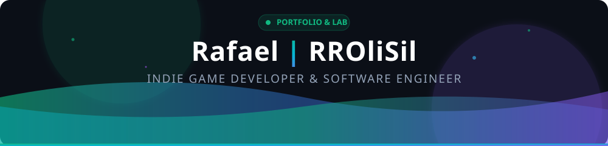
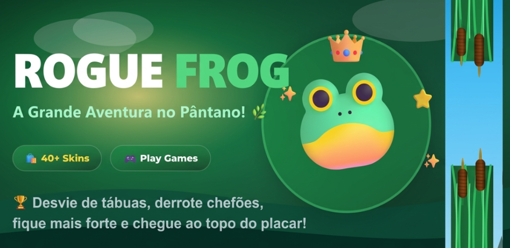

<!-- Header Banner Animado -->

  

<!-- Efeito de Digitação Animado -->

  

---

### 🚀 Projetos em Destaque *(clique em cada card para abrir a descrição detalhada)*

 

<!-- ========================================================= -->
<!-- CARD 1 (DESTAQUE PRINCIPAL): REGZ APP                     -->
<!-- ========================================================= -->
<table width="100%">
  <tr>
    <td>
      

        

          <table>
            <tr>
              <td width="90" align="center" valign="middle">
                
              </td>
              <td valign="middle">
                <h3>🏢 Regz App — Plataforma SaaS de Gestão de Pessoas & Portal de Colaboradores</h3>
                

                  Sistema Full-Stack Multi-Tenant e Multi-Banco em produção 24/7 na nuvem (<b>React 18 • TypeScript • Node.js • Express • PostgreSQL • Docker</b>). 
                  <i>🔽 Clique neste card para expandir toda a arquitetura, funcionalidades de Frontend e Backend</i>
                

                
                
                
                
                
                
              </td>
            </tr>
          </table>
        

         
        

          O <b>Regz</b> é uma plataforma corporativa completa para Gestão de Pessoas, governança de acessos e emissão de relatórios executivos — projetada de ponta a ponta com arquitetura <b>Cloud-Native 24/7</b> (Render + Supabase PostgreSQL SSL em São Paulo <code>sa-east-1</code>).
        

        <h4>💻 Engenharia de Frontend (React + Vite + TypeScript)</h4>
        <ul>
          <li><b>Portal de Colaboradores:</b> CRUD com Soft Delete, validação de CPF, preenchimento automático de endereço via <b>ViaCEP</b>, geocodificação GPS (<b>OpenStreetMap Nominatim + Google Maps</b>), compressão de fotos no navegador (~25KB Base64) + Lightbox e <b>Crachá Digital com QR Code 2D</b> (download PNG e impressão).</li>
          <li><b>Validação Oficial CBO (MTE / eSocial):</b> catálogo oficial com busca por código, título ou sinônimos de mercado e normalização automática.</li>
          <li><b>Campos Dinâmicos Sem Alterar Schema (EAV):</b> criação de campos customizados (Numérico, Texto, Seleção e Sim/Não) com regras min/max e preservação de histórico.</li>
          <li><b>Relatórios & PDF Vetorial Nativo:</b> construtor livre por chips, 3 modos analíticos (Construtor, Geográfico e RBAC), modelos salvos, exportação <b>Excel CSV UTF-8 (BOM)</b> e pré-visualização de <b>PDF vetorial (<code>jsPDF</code>)</b> com alternância Retrato/Paisagem.</li>
          <li><b>UX, Acessibilidade & PWA:</b> 3 temas sincronizados (Deep Indigo, Claro e Escuro), colunas redimensionáveis persistidas em <code>localStorage</code>, Central de Acessibilidade Visual (<code>Alt + A</code>) com <b>Síntese de Voz (TTS pt-BR)</b>, Service Worker e Open Graph dinâmico.</li>
        </ul>
        <h4>⚙️ Engenharia de Backend & Multi-Banco (Node.js + Express + PostgreSQL)</h4>
        <ul>
          <li><b>50+ Endpoints REST & Segurança:</b> autenticação <b>JWT</b>, criptografia <b>bcrypt</b>, middleware granular <b>RBAC</b> (Leitura/Escrita/Sem Acesso), proteção contra força bruta (<code>HTTP 429</code> após 5 falhas) e trilha completa de <b>Logs de Auditoria</b> em <code>JSONB</code>.</li>
          <li><b>Multi-Tenancy & Roteamento Multi-Banco Online:</b> isolamento por <code>empresa_id</code>, cache dinâmico de pools por cliente (<code>getPoolForEmpresa</code>) e testador/provisionador para <b>PostgreSQL, MySQL/MariaDB, MongoDB Atlas e SQL Server</b> via Connection String (URI) com SSL/TLS automático.</li>
          <li><b>Resiliência 24/7:</b> build Docker multi-stage unificado, inicialização com retry (<code>initDbWithRetry</code>) e <code>UNNEST</code> batching em 10 tabelas relacionais.</li>
        </ul>
        

          
          
          
        

      

    </td>
  </tr>
</table>

 

<!-- ========================================================= -->
<!-- CARD 2: ROGUE FROG                                        -->
<!-- ========================================================= -->
<table width="100%">
  <tr>
    <td>
      

        

          <table>
            <tr>
              <td width="130" align="center" valign="middle">
                
              </td>
              <td valign="middle">
                <h3>🐸 Rogue Frog — Roguelike Arcade Mobile (Android)</h3>
                

                  Jogo arcade dinâmico publicado na Google Play Store que combina precisão clássica de desvio com progressão <b>Roguelike</b>, biomas e chefes (<b>JavaScript • HTML5 • Capacitor 7 • Android</b>). 
                  <i>🔽 Clique neste card para expandir as mecânicas e detalhes do jogo</i>
                

                
                
                
                
              </td>
            </tr>
          </table>
        

         
        <table width="100%">
          <tr>
            <td width="58%" valign="top">
              

                Um jogo arcade desafiador para Android que une a precisão clássica de desvio com mecânicas modernas de <b>Roguelike</b>, evolução de habilidades, biomas dinâmicos e batalhas épicas contra chefes!
              

              <ul>
                <li>⚡ <b>Progressão Roguelike:</b> melhorias temporárias e permanentes a cada corrida.</li>
                <li>👹 <b>Batalhas de Chefes:</b> padrões de ataque únicos e desafiadores.</li>
                <li>🌍 <b>Tradução Global:</b> suporte nativo para Português, Inglês e Espanhol.</li>
                <li>🏆 <b>Integração Google Play Games:</b> placares mundiais e conquistas sincronizadas.</li>
                <li>📳 <b>Imersão Háptica:</b> resposta tátil para pulos, acertos e impactos.</li>
              </ul>
              

                
                
              

            </td>
            <td width="42%" align="center" valign="middle">
              
            </td>
          </tr>
        </table>
      

    </td>
  </tr>
</table>

---

### 💻 Minha Tech Stack & Ferramentas

| Categoria | Tecnologias |
| :--- | :--- |
| **Frontend & Web** |       |
| **Backend & Bancos** |       |
| **Cloud & DevOps** |     |
| **Mobile & Publicação** |      |

---

### 📊 Estatísticas do GitHub

  
  

  

---

<!-- Footer Wave Animado -->

<i>"Grandes sistemas e grandes jogos nascem da mesma disciplina: um salto bem construído de cada vez." 🚀🐸</i>

